<p align="center">
  
</p>

<p align="center">
  
</p>

# SF PortalGuns Extension

> **Portal technology for DrakesCraft's Slimefun progression.** Circular named portals, green Portal Fluid, saved destinations and a Gravity Gun — all server-side on Paper/Purpur 1.21.11.

[](https://drakescraft.cl)
[](https://papermc.io)
[](https://adoptium.net)

## What it adds

- **Portal Gun** — fires a linked pair of circular portals. Each gun keeps its own portal name and color.
- **Portal Fluid** — green fuel that refills a gun to 100 charge from the off-hand.
- **Saved travel** — eight destinations per gun; travel consumes charge and validates a safe arrival point.
- **Native 1.21.11 panel** — Shift + right-click opens a Minecraft Dialog with name, color, mode, destination and staff infinite-mode controls.
- **Visual portals** — a ring of display entities plus a floating `I` / `II` label. No permanent blocks and no continuous particle emitter.
- **Gravity Gun** — grabs and moves permitted entities and blocks.

## Using a Portal Gun

1. Craft **Portal Fluid** and a **Portal Gun** in the Magic Workbench.
2. Hold Portal Fluid in the off-hand and right-click to refill.
3. In **Linked** mode, right-click twice on valid surfaces to create the pair.
4. In **Saved** mode, use the native panel to save and select destinations, then right-click to travel.
5. Use `/pg name <name>` or `/pg color <lime|cyan|purple|orange|red|blue>` for fast edits. `/pg legacy` opens the transitional inventory panel for deleting saved locations.

## Safety and compatibility

| Area | Behavior |
|---|---|
| Server | Paper/Purpur **1.21.11**, Java **21** |
| Dependency | [Slimefun4-Drake](https://github.com/SlimefunNewHorizons/Slimefun4-Drake) |
| Claims | Checks Slimefun's protection manager for placement and both ends of travel, covering ProtectionStones and compatible regions |
| Cooldown | 10 seconds between portal teleports |
| FAWE | Portal creation does not edit blocks; it uses display entities only |
| Bedrock | Test through current Geyser/Floodgate before making native dialogs mandatory in a player flow |

## Build

```bash
mvn clean package
```

The artifact is `target/sfportalguns-extension-1.1.0-SNAPSHOT.jar`.

## Permission

| Permission | Effect |
|---|---|
| `sfportalguns.infinite` | Allows staff to toggle unlimited charge. Defaults to OP. |

## Attribution and license

Original code: **officialdakari**. DrakesCraft/Slimefun New Horizons maintains the 1.21.11 port and extensions. Licensed under **GPL-3.0-only**.
